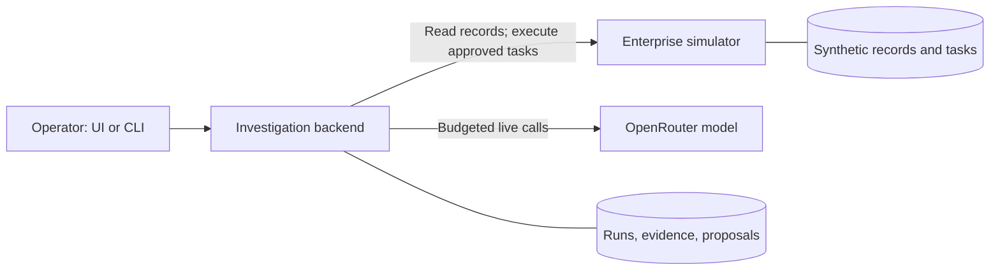

# CasePilot

**An evidence-grounded AI investigation workflow with human-controlled execution.**

CasePilot investigates stalled **synthetic insurance cases**, explains its findings using retrieved records, and recommends a next action. If it proposes a follow-up task, an operator must approve the stored payload before the simulator creates it.

This independent portfolio demo uses no real customer data and does not represent any insurer's systems or requirements. It runs locally; it is not production software.

## Engineering highlights

- **Explicit system boundaries:** the investigation backend and enterprise simulator own separate databases and communicate over authenticated HTTP. The UI never accesses enterprise storage directly. [Architecture →](docs/architecture.md)
- **Constrained AI, controlled writes:** case-bound read tools, run-scoped citation checks, digest-pinned proposals, and operator approval separate model recommendations from task execution. [Investigation flow →](docs/architecture.md#investigation-to-approved-task)
- **Budgeted and testable model access:** reserve/settle cost accounting, conservative handling of missing usage, and offline scripted-model tests make failure behavior explicit. [Cost controls →](docs/architecture.md#cost-controls)

## Architecture at a glance

The model can investigate and recommend; the backend owns validation and approval state. Only an explicit operator decision enables the simulated write path. **[Explore the design, sequence diagram, and trade-offs →](docs/architecture.md)**

**Stack:** Python / FastAPI / LangChain / SQLite; React / TypeScript / Vite; `uv`, pytest, Ruff, and mypy.

## Evidence—and its limits

| Recorded check                         | Result                                                                    |
| -------------------------------------- | ------------------------------------------------------------------------- |
| Held-out synthetic evaluation, **N=8** | Category 7/8; evidence IDs 7/8; action 6/8; no hard failures              |
| CASE-001 live smoke                    | Completed with five accepted evidence references; model spend $0.00169768 |
| Offline quality checks                 | Reproducible lint, typecheck, tests, and frontend build commands          |

These small demonstrations **do not establish production accuracy**. Citation checks validate references, not whether every claim follows from them. Local token auth is not enterprise identity; the cost ledger is application policy, not a provider hard cap. Historical UI recovery/retry remained unverified in the manual pass.

[Evaluation methodology, failures, and caveats →](docs/evaluation.md) · [Sanitized report →](docs/sample-evaluation.json)

## Run it / read more

- **[Quickstart](docs/quickstart.md):** prerequisites, local setup, CLI usage, and offline quality checks.
- **[Architecture](docs/architecture.md):** ownership, investigation flow, approval safeguards, and trade-offs.
- **[Evaluation](docs/evaluation.md):** recorded results, scoring, costs, and limitations.
- **[Operator UI](docs/operator-ui.md):** screens, local credential wiring, and manual verification status.

Setup and offline tests need no model API key. **Live Investigate and live evaluation are paid opt-ins**; do not run them without explicit authorization.
