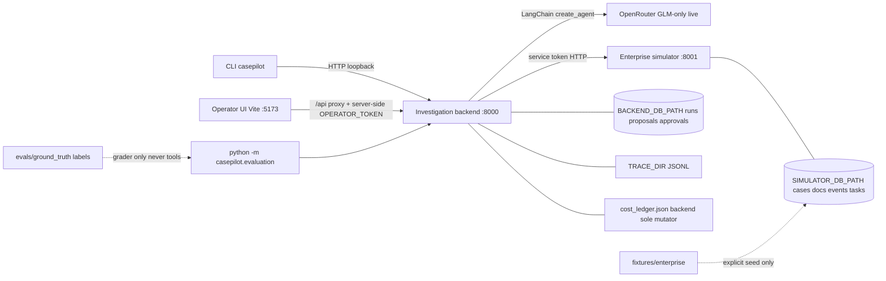

# CasePilot architecture

Independent local portfolio demo. CLI/API plus optional **local-only operator UI**. **No Docker, no production hosting.** Git history may be uninitialized in a fresh tree (`git_revision: unavailable` in reports).

## Runtime topology

## Ownership

| Component                 | Owns                                                                         | Does not own                                                |
| ------------------------- | ---------------------------------------------------------------------------- | ----------------------------------------------------------- |
| Simulator                 | Synthetic enterprise records + follow-up task rows                           | Model calls, proposals, operator identity                   |
| Backend                   | Runs, immutable proposals, approval state, traces, **live cost ledger**      | Simulator SQLite                                            |
| CLI                       | Operator HTTP client                                                         | Business rules                                              |
| Operator UI (`frontend/`) | Local presentation of cases, findings, history, approve/reject/retry         | Simulator access, credentials in assets, production hosting |
| Evaluation                | Offline grading + live opt-in runner (reads ledger; does not double-reserve) | Prompt tuning from labels                                   |

## Trust boundaries

- Loopback bind only (`127.0.0.1`).
- `SIMULATOR_SERVICE_TOKEN` / `OPERATOR_TOKEN` never enter model context, traces, or CLI stdout.
- Operator UI: browser uses same-origin `/api` only. Vite dev proxy may attach `OPERATOR_TOKEN` from root `.env` via **non-`VITE_`** server-side config for approve/reject. **No** simulator credential in the browser; UI never calls the simulator directly.
- Model tools: case-bound reads only; writes require stored proposal + operator approve.
- Evidence citations validated against retrievals for that run (ID + `retrieval_ref`, not semantic proof).
- Live spend: application **$5** envelope, **`z-ai/glm-5.3-flash` only**; not a provider hard cap. UI Investigate is a paid path — no calls without explicit authorization.

## Operator UI scope (summary)

Case list → case detail → default Investigate → findings/evidence/proposal on one page → approve & execute / reject (pending) / retry (approved unfinished or execution_failed). History is persisted backend state. No streaming, login redesign, record browser, bulk actions, auto-retry, or production packaging.

Manual verification status lives in root `README.md` § Operator UI: observed paths verified (incl. loading/duplicate-guard and inline network-error preservation, offline); **execution recovery/retry unavailable** — **not** claimed verified; spec **not** fully validated.

## Deferred

Docker, production frontend hosting, cloud deploy, CI, LangSmith, multi-user auth/RBAC, multi-agent graphs, real insurer systems.
