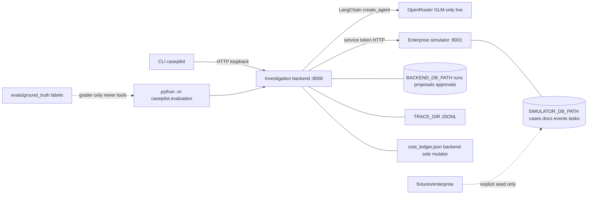

# CasePilot architecture

Independent local portfolio demo. CLI/API only — **no UI, no Docker**. Case list/summary HTTP APIs added for operator discoverability. Git history may be uninitialized in a fresh tree (`git_revision: unavailable` in reports).

## Runtime topology

## Ownership

| Component | Owns | Does not own |
|---|---|---|
| Simulator | Synthetic enterprise records + follow-up task rows | Model calls, proposals, operator identity |
| Backend | Runs, immutable proposals, approval state, traces, **live cost ledger** | Simulator SQLite |
| CLI | Operator HTTP client | Business rules |
| Evaluation | Offline grading + live opt-in runner (reads ledger; does not double-reserve) | Prompt tuning from labels |

## Trust boundaries

- Loopback bind only (`127.0.0.1`).
- `SIMULATOR_SERVICE_TOKEN` / `OPERATOR_TOKEN` never enter model context, traces, or CLI stdout.
- Model tools: case-bound reads only; writes require stored proposal + operator approve.
- Evidence citations validated against retrievals for that run (ID + `retrieval_ref`, not semantic proof).
- Live spend: application **$5** envelope, **`z-ai/glm-5.3-flash` only**; not a provider hard cap.

## Case browsing APIs

- Simulator `GET /v1/cases` (service token): full case records.
- Backend `GET /v1/cases`: list with independent `pending_review` / `needs_execution` proposal flags.
- Backend `GET /v1/cases/{case_id}`: brief operator `CaseSummary` (not full simulator record).

No operator UI yet.

## Deferred

UI, Docker, LangSmith, cloud deploy, multi-agent graphs, real insurer systems.
