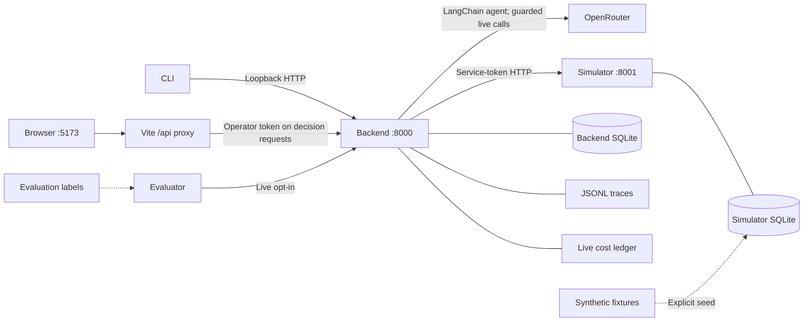
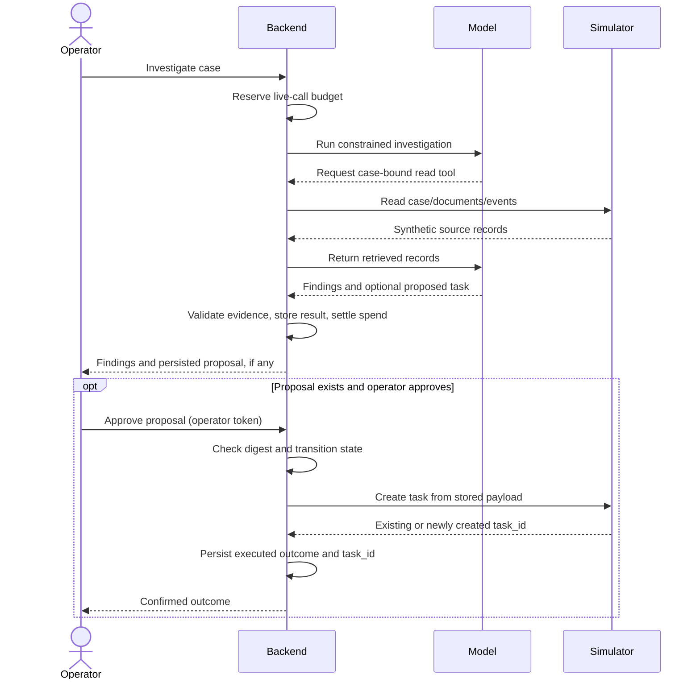
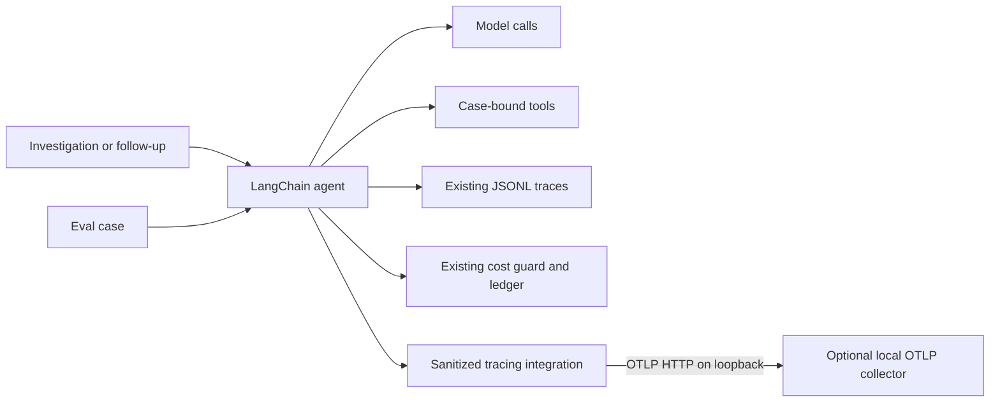
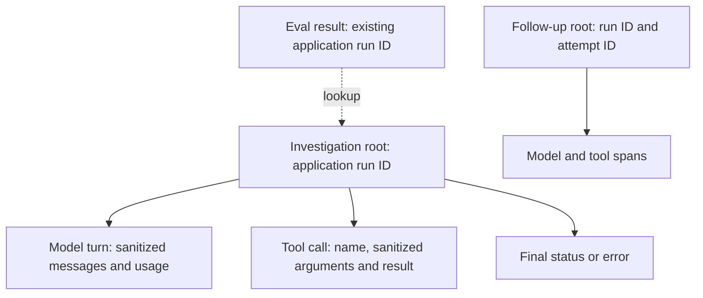

# CasePilot architecture

[Overview](../README.md) · [Quickstart](quickstart.md) · [Evaluation](evaluation.md) · [Operator UI](operator-ui.md)

CasePilot separates an AI recommendation from an authorized action. The model reads synthetic case records; the backend validates findings and stores proposals; an operator decides whether the simulator should create a follow-up task. This is a local demonstration, not a production insurance integration.

## Components and ownership

| Component                                           | Owns                                                                                         | Boundary                                                         |
| --------------------------------------------------- | -------------------------------------------------------------------------------------------- | ---------------------------------------------------------------- |
| [Simulator](../src/casepilot/simulator/)            | Cases, documents, events, executed tasks                                                     | Does not orchestrate the model or own approvals                  |
| [Backend](../src/casepilot/backend/)                | Runs, proposals, decisions, conversations, evidence snapshots, traces, live spend accounting | Never reads simulator SQLite directly                            |
| [CLI](../src/casepilot/cli.py) / [UI](../frontend/) | Operator interaction                                                                         | Do not own execution rules                                       |
| [Evaluator](../src/casepilot/evaluation/)           | Scoring and opt-in experiment runners                                                        | Labels are not model tool inputs; no duplicate cost reservations |

Separate stores make authority visible: `SIMULATOR_DB_PATH` holds enterprise records and tasks; `BACKEND_DB_PATH` holds investigation state. HTTP preserves this boundary even though both services run on one machine. It also introduces network failures that a single-process demo could avoid.

## Investigation to approved task

1. An operator selects a case and requests an investigation. The backend runs a LangChain `create_agent` with case-bound reads for the case, documents, and events—no generic HTTP, SQL, or filesystem tool.
2. Retrieved records populate a run-scoped evidence index. The backend validates cited record IDs and field paths before accepting findings.
3. The result includes a diagnosis, uncertainty, and recommended next action. It may include a follow-up-task proposal; a findings-only result requires no approval controls.
4. A proposal stores the exact task payload and its digest. An authenticated operator can reject a pending proposal or approve and execute it.
5. The backend sends the **stored payload**, not freshly generated model output, to the simulator. A successful execution persists the simulator's `task_id`.

For example, the recorded CASE-001 smoke retrieved evidence for a missing document and recommended requesting it. That run produced **no proposal**: it demonstrates investigation, not approval. The following sequence shows the separate proposal-present path supported by the implementation, not a claim about that smoke run.

The model/tool exchange can repeat within execution limits; the diagram condenses it for readability. Execution defaults include a 60-second investigation timeout, 10-second tool HTTP timeout, 12 tool calls, and 8 model turns.

### Proposal integrity and recovery

The [backend decision handlers](../src/casepilot/backend/app.py) check the stored payload digest before decisions. [Database transitions](../src/casepilot/backend/db.py) update status atomically with allowed-source-state guards. Payloads are digest-pinned and not updated by these transitions; this is not a database-level prohibition on all possible payload edits.

- Pending proposals can be rejected or approved. The model cannot set approval state.
- Approval executes immediately. HTTP execution failure records `EXECUTION_FAILED`; approved unfinished or failed executions can retry the stored payload through the approval endpoint. Rejection is not available after approval.
- The [simulator store](../src/casepilot/simulator/store.py) deduplicates by proposal ID, uses a deterministic task ID and a uniqueness constraint, and rejects conflicting payloads. This supports retry after an ambiguous network response without creating a second task for that proposal; it is not a general distributed exactly-once guarantee.
- Successful execution persists the confirmed task ID. Historical nullable IDs are not fabricated.

The operator UI's historical manual pass did not observe a recovery/retry state. Implemented recovery behavior and observed UI coverage are distinct; see the [verification checklist](operator-ui.md#manual-verification-checklist).

## Grounding and follow-up chat

[Evidence validation](../src/casepilot/backend/evidence.py) checks that a cited record was retrieved in the current run and that its dotted field path exists. Retrieved content is untrusted data, not instructions. These checks constrain references; they **do not prove semantic entailment** or eliminate prompt-injection risk.

Eligible completed/indeterminate runs also support read-only follow-up chat. The model selects references into server-owned evidence snapshots; the server renders values rather than trusting model-generated facts or timestamps. Invalid rendering falls back to safe uncertainty. Conversation send/retry is persisted and idempotent; interrupted pending attempts recover on startup. Chat cannot create tasks.

This trades open-ended conversational freedom for inspectable, bounded answers. Runtime reference checks and the evaluator's evidence score are different controls; see [evaluation caveats](evaluation.md).

## Cost controls

The [backend cost guard](../src/casepilot/backend/cost_guard.py) is the sole mutator of the shared [cost ledger](../src/casepilot/evaluation/cost.py) for live investigations. Evaluation runners do not double-reserve.

1. **Reserve:** check the model allowlist, pricing reliability, and available budget before billable work. Conservative bounds use local price tables, token ceilings, and the maximum model turns; model construction also pins provider price limits.
2. **Settle:** charge reported usage and reconcile the reservation.
3. **Missing usage:** after provider involvement, charge the full reserve and mark pricing unreliable, pausing further live calls.
4. **Release:** release a reservation only when the provider was never contacted.

The application envelope is **$5 total**, with live calls restricted to `z-ai/glm-5.3-flash`. Exhaustion, an unsupported model, or unreliable pricing raises `CostPause`. The default ledger is `evals/reports/cost_ledger.json`; `CASEPILOT_COST_LEDGER_PATH` overrides it and must agree across participating processes.

This is conservative **application policy**, not an account-level provider hard cap or a per-case price promise. Use provider account limits for an external hard stop. Current spend belongs in the operational ledger, not a duplicated architecture snapshot.

## Local observability (sanitized OTLP)

Optional **local OTLP export** sits beside existing JSONL traces and the cost ledger. It does not add agent tools, change grading, or mutate spend accounting. A compatible loopback collector/viewer is optional and separate from the backend process.

### Component responsibilities

| Piece | Role |
| --- | --- |
| Backend agent / follow-up paths | Produce application run IDs (and attempt IDs for follow-ups); emit sanitized spans only when tracing is enabled |
| Existing `TraceWriter` JSONL (`TRACE_DIR`, default `traces/`) | Authoritative application audit trail for tools, outcomes, evidence snapshots |
| Cost guard + ledger | Authoritative usage/cost; exporters must not charge or reserve |
| Sanitized OTLP exporter (`casepilot.backend.tracing`) | Explicit LangChain callback spans only; loopback OTLP HTTP; redacts before export |
| Evaluator | Grades saved or live results; correlates to traces by **existing application run ID** only |

### Local-only export and privacy

- Backend export uses `TRACING_ENABLED` / `TRACING_OTLP_ENDPOINT` (default `http://127.0.0.1:6006/v1/traces`). Non-loopback endpoints are rejected; export disables rather than sending remotely.
- No Docker requirement, no cloud account, no implicit remote exporters from the app.
- Content that leaves the backend must pass application-controlled sanitization first (secrets, bearer credentials, provider reasoning fields). Built-in hide flags alone are not the boundary.
- Collector absent or tracing disabled must not fail or materially delay investigation, follow-up, or eval. JSONL tracing remains available.

### Correlation (no new identity plane)

- Investigations and eval-triggered agent runs share the existing application **run ID**.
- Follow-ups also carry **attempt ID**.
- Eval lookup uses run IDs already present in results. Do not push labels, expected answers, or extra eval metadata into the backend for tracing.
- Report-only / offline grading of saved results performs **no** agent execution and creates **no** execution trace.
- Token usage and cost appear in traces only when the existing normalized usage path supplies them; missing stays missing.

Export settings: [quickstart](quickstart.md#backend-otlp-export). Eval lookup workflow: [evaluation](evaluation.md#trace-lookup-for-eval-results).

## Local trust and test boundaries

- Services bind loopback. Backend-to-simulator requests use `SIMULATOR_SERVICE_TOKEN`; approve/reject use `OPERATOR_TOKEN`.
- The browser calls Vite's same-origin `/api` proxy, not the simulator. The proxy adds the operator token server-side using non-`VITE_` configuration. Neither service credentials nor the OpenRouter key belong in frontend assets.
- This local proxy wiring is **not** a login system, multi-user authorization, TLS deployment, or production browser-security design.
- [Model construction](../src/casepilot/backend/agent.py) fails closed when `CASEPILOT_TEST_MODE=1` has no installed scripted/hook model: it refuses live fallback. Scripted paths do not bill or mutate the live ledger. This guarantee is specific to test mode, not a claim that all application paths are offline.
- Test mode alone registers simulator outage-injection routes, permitting reversible domain-route 503s while health stays available. They are absent outside test mode.

Run the [offline quality gates](quickstart.md#quality) without OpenRouter. Live evaluation and UI Investigate remain separate, explicitly authorized paid paths.

## Trade-offs and limits

- **Synthetic scope:** authored fixtures and a small evaluation demonstrate mechanics, not insurance-domain reliability or generalization.
- **One write path:** only simulated follow-up-task creation. No payments, coverage changes, external messaging, or autonomous underwriting.
- **Local simplicity:** SQLite, synchronous REST, and a Vite development proxy keep the demo inspectable; they do not establish production scalability or deployment security.
- **Human control:** approval adds review friction but keeps recommendations separate from execution. Payload integrity protects the reviewed task, not the correctness of the recommendation.
- **Deliberately bounded agent:** LangChain tools and structured output, not a custom graph or multi-agent system. No generic tool access, streaming tool feed, bulk actions, or automatic retries.
- **Deferred work:** production hosting/packaging, Docker, hosted CI, enterprise identity/RBAC, and real insurer integrations. Future work should establish stronger evaluation and semantic checks before expanding autonomy.
- **Observability scope:** Local sanitized OTLP export only—no CI dashboards, cloud export, prompt management, retention automation, or replacement of JSONL/cost authority.
