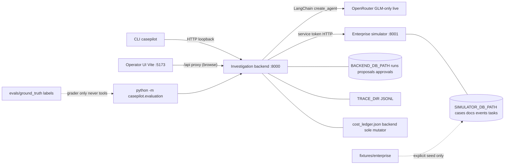

# CasePilot architecture

Independent local portfolio demo. CLI/API plus optional **local-only operator UI** for **case browsing**. **No Docker, no production hosting.** Git history may be uninitialized in a fresh tree (`git_revision: unavailable` in reports).

## Runtime topology

## Ownership

| Component | Owns | Does not own |
|---|---|---|
| Simulator | Synthetic enterprise records + follow-up task rows | Model calls, proposals, operator identity |
| Backend | Runs, immutable proposals, approval state, traces, **live cost ledger** | Simulator SQLite |
| CLI | Operator HTTP client | Business rules |
| Operator UI (`frontend/`) | Local case list + brief summary | Simulator access, credentials in assets, investigate/history/decisions (later), production hosting |
| Evaluation | Offline grading + live opt-in runner (reads ledger; does not double-reserve) | Prompt tuning from labels |

## Trust boundaries

- Loopback bind only (`127.0.0.1`).
- `SIMULATOR_SERVICE_TOKEN` / `OPERATOR_TOKEN` never enter model context, traces, or CLI stdout.
- Operator UI: browser uses same-origin `/api` only. Vite dev proxy may attach `OPERATOR_TOKEN` from root `.env` via **non-`VITE_`** server-side config for future approve/reject. **No** simulator credential in the browser.
- Model tools: case-bound reads only; writes require stored proposal + operator approve.
- Evidence citations validated against retrievals for that run (ID + `retrieval_ref`, not semantic proof).
- Live spend: application **$5** envelope, **`z-ai/glm-5.3-flash` only**; not a provider hard cap.

## Case browsing APIs

- Simulator `GET /v1/cases` (service token): full case records.
- Backend `GET /v1/cases`: list with independent `pending_review` / `needs_execution` proposal flags.
- Backend `GET /v1/cases/{case_id}`: brief operator `CaseSummary` (not full simulator record).
- Backend `GET /v1/cases/{case_id}/runs`: persisted `RunSummary` history (newest first); 404 if case unknown to simulator.

## Operator UI scope (this slice)

Case list → select case → brief summary. No Investigate, findings, history panel, or proposal decisions yet.

## Deferred

Investigation/history/proposal decision UI, Docker, production frontend hosting, cloud deploy, CI, LangSmith, multi-user auth/RBAC, multi-agent graphs, real insurer systems.
