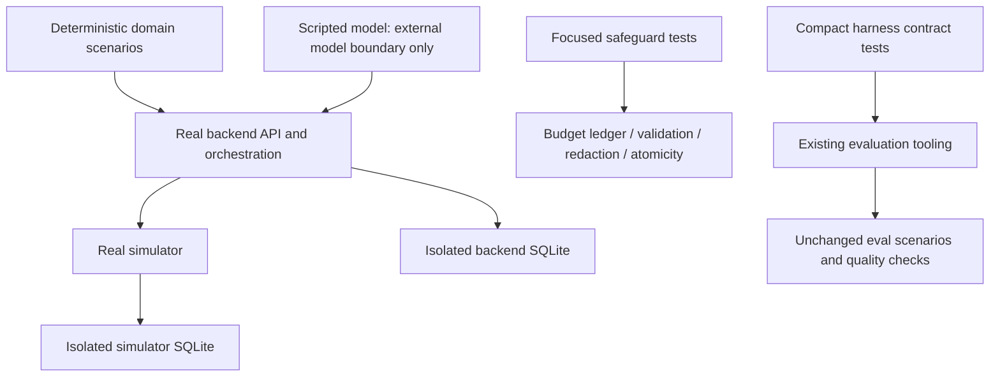

# Testing suite consolidation — spec

Status: **Historical first-pass (superseded for further cuts).** Reached **382** from **403** (−21, ≈5.2%) via replacement maps + thin slices. **Superseded** by risk-based deletion in [testing-risk-redesign.md](testing-risk-redesign.md) (current inventory/guarantee map: [testing-audit.md](testing-audit.md), **183** collected after +3 review restores; −54.6% vs 403). Keep this file for first-pass decisions/history only — do not treat assertion-for-assertion preservation as the live policy.

## Decisions

1. Reduce testing complexity with an actual drop in collected cases. Prefer **deep tests** (small scenario interface, substantial real behavior, several related guarantees). No parametrization packs or mega-tests that fake reduction.
2. Mandatory coverage: evidence-backed investigation, approved follow-up execution, prevention of unapproved actions, budget enforcement, sensitive-data protection.
3. Preserve meaningful behavioral guarantees cheaply; not every implementation assertion.
4. Preserve eval tooling, scenarios, datasets, calibration assets, commands, semantics. Simplify supporting tests only.
5. Domain tests: real backend/simulator, isolated SQLite, scripted model at external boundary. E2E = backend, not browser.
6. Model quality stays with evals, not deterministic app tests.

## Baseline → final

| Metric | Historical baseline | Final |
| --- | --- | --- |
| Collected / passed | **403** / 5.75s | **382** / **5.59s** (duration essentially unchanged; not a perf claim) |
| Net | — | **−21** (≈**5.2%**) |
| Typecheck | 35 files | **PASS (35)** |
| Lint | pass | **PASS** (**70** formatted) |
| Reviews | — | Spec + quality **PASS** (format resolved) |
| Manual | — | Playwright/CLI **PASS** (backend + eval paths only — **no** browser test suite added) |
| Warning | langchain Pydantic V1 / Py≥3.14 | same baseline noise |

Eval assets (six pilot scenarios, 12 dev GT cases, eight held-out per docs) **preserved**. Frontend: no tests.

### Applied maps (summary)

| Slice | Map | Net |
| --- | --- | ---: |
| Backend approval-workflow | 6 → 4 | −2 |
| Eval coverage gate | 9 → 5 | −4 |
| Judge contracts | 12 → 3 | −9 |
| Scorecard aggregation | 3 → 1 | −2 |
| Follow-up wrapper/runtime | see audit | −3 |
| Startup/store recovery | see audit | −1 |
| **Total** | | **−21** |

**Rejected (calibration):** grader pack 11→3 — count packing + helper duplication (+80 LOC); independent grader tests **retained**.

**Retained as distinct:** safety, observability, assets, charging/budget, assessment-honesty body, live/ledger judge branches, simulator + E2E smoke, etc. Further high-confidence cuts are **diminishing returns**; **do not claim** remaining cases are redundant.

## Standing bar (autonomous verified removals)

1. Replacement (or documented pure redundancy) **before** delete.  
2. Exact guarantee map + collected counts + rationale (audit).  
3. Representative **fault** evidence; proportionate review.  
4. Mandatory matrix held (budget stays **focused** — scripted paths bypass ledger).  
5. **Escalate** material regressions or meaningful behavior loss.  
6. Reject count packing / LOC inflation disguised as simplification.

## Target boundaries

## Required behavior matrix

| Area | Required outcomes | Primary boundary |
|---|---|---|
| Investigation | Evidence-backed findings; reject fabricated/invalid paths; persisted results | Domain + focused validation |
| Action authorization | No exec before approval; reject terminal; unauthorized denied | Domain |
| Execution lifecycle | Approve runs intended task; no duplicate side effects; failure/retry + recovery keep task identity | Domain + targeted persistence |
| Follow-up | Context-aware; safe insufficient evidence; no approval bypass | Domain + atomicity |
| Budget | Reserve/settle, limits, no unintended paid calls | **Focused** charging-boundary tests |
| Privacy | Secrets/CoT redacted externally; domain reasons kept | Focused redaction |
| Simulator | Auth/errors/outage; essential persistence | Domain or focused integration |
| Eval harness | Scoring/aggregation; fail-closed judge; live/budget gates; coverage/ledger/resume; offline report | Compact contracts |
| Deployment | Real processes, HTTP, CLI, persistence, idempotent reapproval | E2E smoke |

### Budget limitation

Scripted-model mode **bypasses** the cost ledger. Domain/scripted green ≠ paid-provider proof. Keep focused budget tests.

## Procedure (ongoing)

Inventory → map guarantees → classify → add replacements → fault-check → remove when bar met → full deterministic suite + lint/typecheck → report actual reductions. Paid/live eval still needs separate permission.

## Non-goals

No product/eval-harness rewrite, browser tests, CI rollout, new framework, coverage %, headcount ceiling, scenario/dataset deletion, or deleting prod code only because tests shrank.

## Acceptance

- Final **382** vs baseline **403** (−21, ≈5.2%) with maps applied and mandatory coverage held.  
- Full confirmation: pytest/lint/mypy green; spec+quality PASS; manual Playwright/CLI only (no browser suite).  
- Autonomous further removals only under standing bar; escalate material harm.  
- No claim that all remaining tests are redundant.

## Authorized now

| Yes | No / escalate |
| --- | --- |
| Applied maps; autonomous verified-safe removals under bar | Silent delete; paid eval without permission |
| Documenting rejected packs (grader) as calibration | Count packing / mega-helpers |
| Retaining distinct safety/obs/assets/charging cases | Claiming remainder all redundant |
| Reporting real −N only | Fixed headcount targets |
