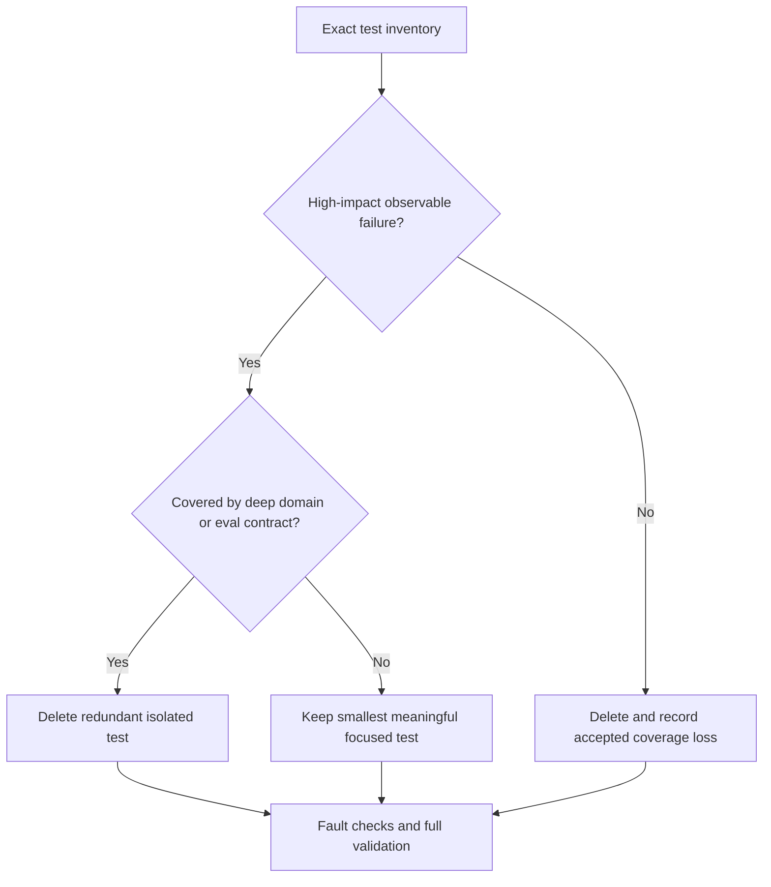

# Risk-based testing redesign

Status: **Approved, implemented, and final-validated** (suite **183 passed**). Supersedes assertion-for-assertion preservation in [testing-audit-spec.md](testing-audit-spec.md). Living inventory and guarantee map: [testing-audit.md](testing-audit.md).

User chose risk-based **deletion without replacement** after the first pass reached **382** (from **403**). Current: **183** (−220 from 403 = **54.6%**; −199 from 382 = **52.1%**), including **+3** review restores (empty-ref scoring, offline report pipeline, follow-up timeout→failed).

## Goal

A substantially smaller, simpler suite built around deep domain tests, not exhaustive implementation branches. Delete low-value tests outright; do **not** preserve scenarios in loops, tables, parametrization, or giant functions merely to lower collection count. Production behavior, evaluation tooling, datasets, scenarios, and references remain unchanged. **No equivalence** claim vs the old 403/382 assertion set.

## Coverage budget

Planning envelope ~**150–220** collected cases — not a quota to delete safeguards. Current **183** sits inside the envelope after adversarial restore of three critical paths. Reject merge-only “simplifications” that hide independent scenarios.

## Required retained guarantees

- Real backend + simulator + SQLite investigation → approval → execution; no execution without approval; unauthorized callers cannot approve or execute (**denial** at real backend boundary; exact denial-**trace schema** not required); rejection terminal; idempotent side effects; retry and restart recovery.
- Evidence validation, cross-case/run isolation, sensitive-data and reasoning redaction, safe insufficient-evidence handling; representative follow-up including **timeout→failed**.
- Charging-boundary reserve/settle/release, budget/input/tool limits, explicit live opt-in and reliable-price gates. Scripted ledger bypass is **not** proof of paid enforcement.
- Eval **scoring truth** (failures in denominator, empty retrieval-ref rules), judge fail-closed, required-retrieval coverage gate, calibration and **report/resume** integrity (incl. offline report pipeline) where invalidity could false-claim quality or cause unintended spend.
- Existing real-process backend E2E. **No browser test suite** (manual Playwright/CLI only; eval viewer-only caveat).

## Intentionally reduced coverage (accepted losses)

| Category | Note |
| --- | --- |
| Auth-denial **trace emission schema** | Denial **behavior** retained; schema/event shape not |
| Exhaustive asset-loader **mutation** matrices | Dropped; do **not** claim “no composition anywhere” — e.g. `test_fixtures` still retains **GT split** composition |
| Individual composition micro-assertions | Many removed; representative composition may remain inside kept fixtures/workflows |
| Exact render / parser / follow-up diagnostics files | Removed entirely (`test_followup_render_diagnostics`, `test_followup_output_diagnostics`) |
| Schema/enum/serialization/route-template-only; private helpers; redundant tracing/event-schema; repetitive orchestration plumbing; legacy wrappers | Deleted without replacement when low-impact |

Security, spend, and scoring-truth failures are **not** dismissed as formatting.

## Selection rules

1. Inventory exact kept nodes before editing; tag retained critical guarantees and intentionally abandoned categories.
2. Prefer deep backend and eval contracts; keep a focused unit only for important modes those cannot cover economically.
3. **Delete low-value without replacement** — no packing independent scenarios into loops/tables/mega-tests. Merge only when asserts share one workflow/result.
4. Preserve distinct high-impact safety/budget mechanisms, not every historical input. Record gaps; **no equivalent-coverage claims**.
5. No new fixture framework, production changes, paid calls, or eval asset deletion. Remove unused test helpers/imports.

## Execution and gates

Parallel owners shipped disjoint slices with kept/deleted nodes, counts, accepted loss, and critical-fault notes. Gates below are the **final confirmation** (after +3 review restores).

User authorizes autonomous safe deletion, not silent safeguard loss. Escalate env blockers; do not “fix” by installing credentials.

### Acceptance (final confirmation)

| Criterion | Status |
| --- | --- |
| Substantial case reduction | **met** — 403→183 (54.6%) |
| Mandatory guarantees mapped | **met** — see audit |
| Accepted losses documented | **met** — non-equivalent |
| No loop packing / eval asset / prod churn | **met** by policy |
| `pytest` | **183 passed**, **4.85s**, one baseline warning (single run — **no stronger speed claim**) |
| `make lint` | **PASS** (**68** formatted) |
| mypy | **PASS** (**35** source files) |
| Spec review (small) | **PASS** (after +3 restores) |
| Quality/simplicity (medium) | **PASS** (after +3 restores) |
| Manual backend/eval (both sessions) | **PASS** (eval viewer-only caveat) |

Report baseline and final counts honestly. No promise to preserve every former assertion or to improve runtime.
